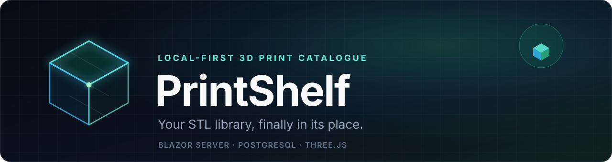
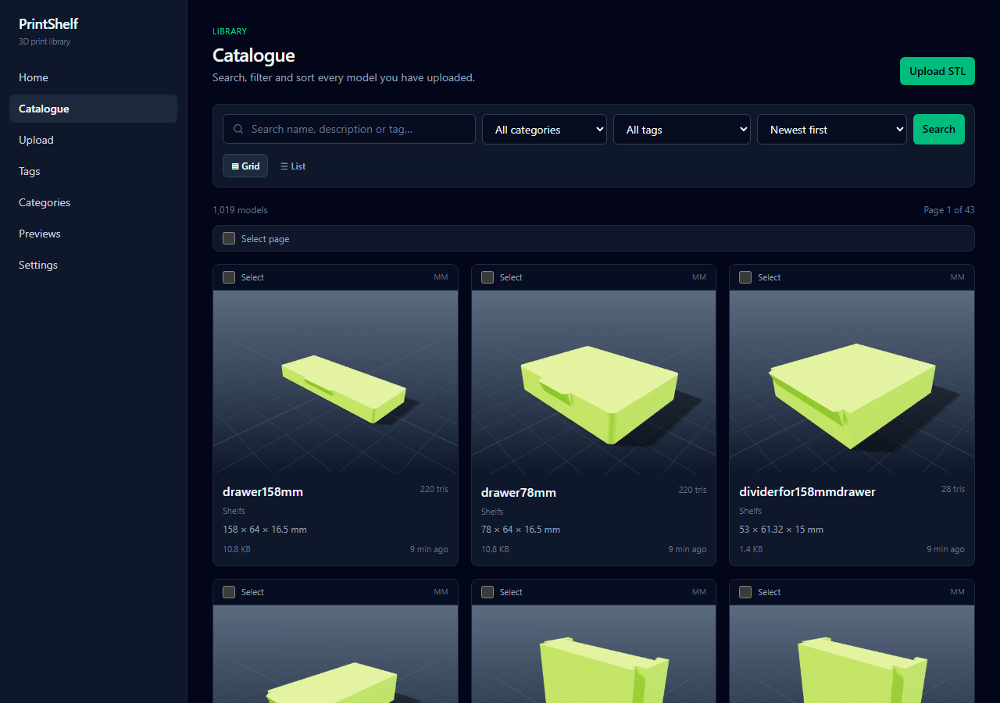
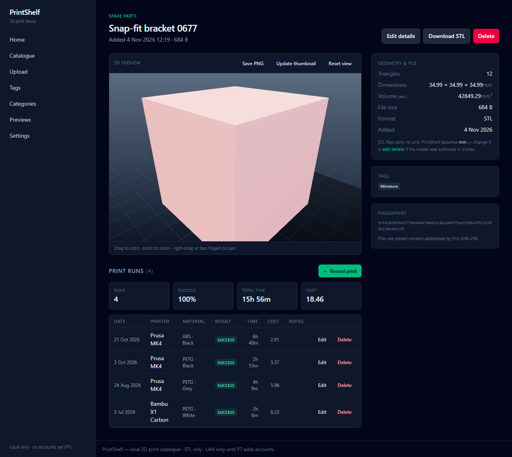
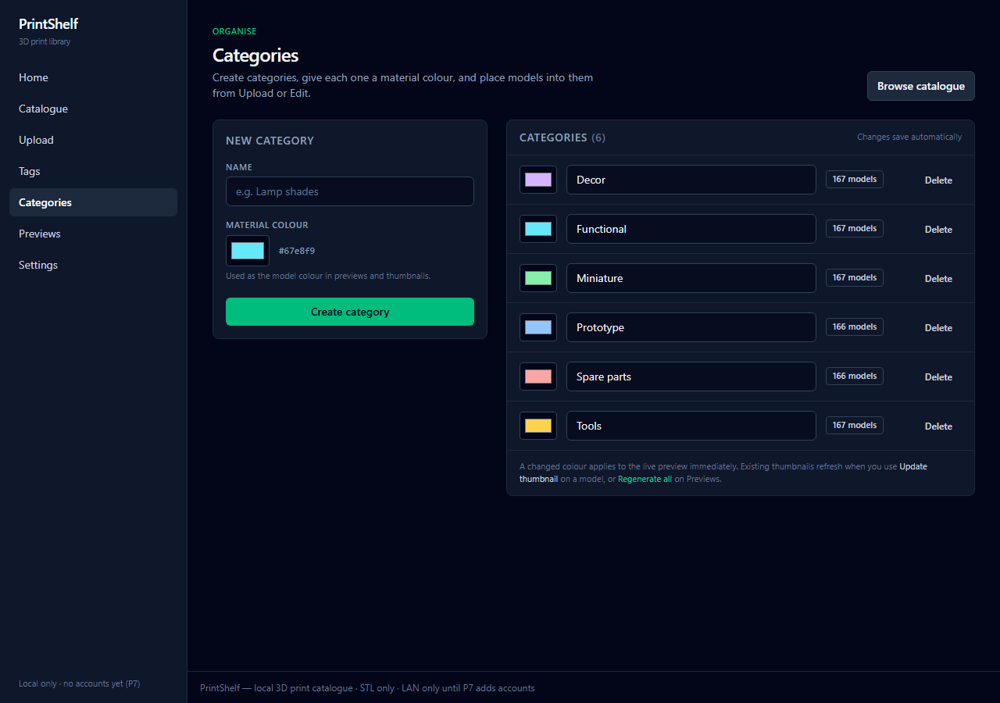
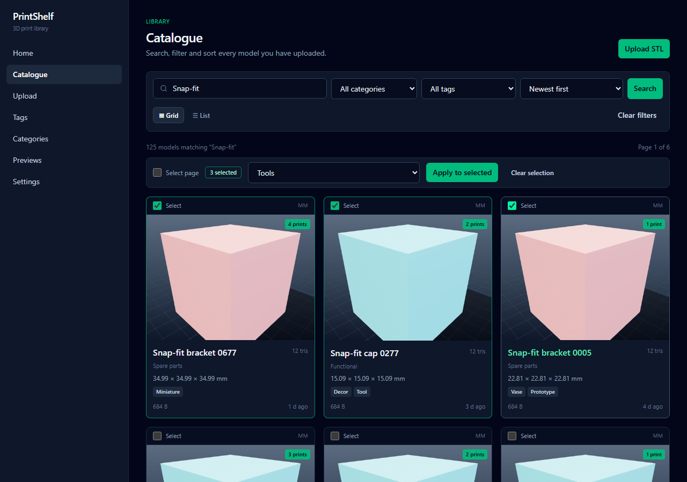
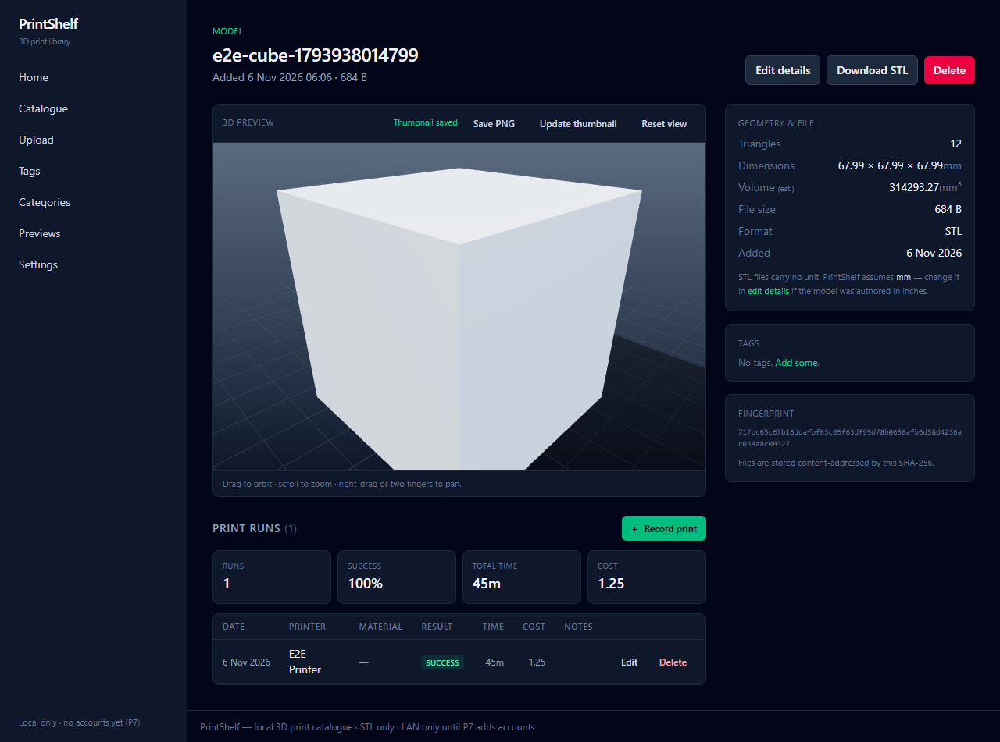
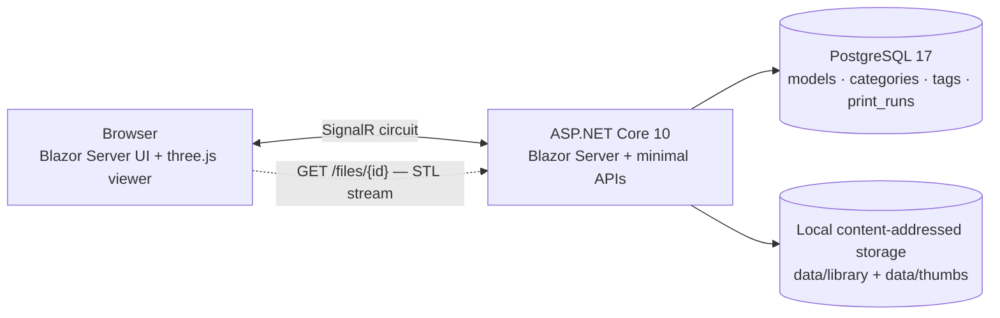

<p align="center">
  
</p>

<h1 align="center">PrintShelf</h1>

<p align="center">
  <strong>A local-first 3D print library that feels like a product.</strong><br>
  Upload STLs, explore them in a browser-native 3D viewer, organise every model with colour-coded categories,<br>
  and keep the print history that belongs to your shelf.
</p>

<p align="center">
  
  
  
  
  
  
  <a href="LICENSE"></a>
</p>

<p align="center">
  <a href="#why-printshelf">Why PrintShelf</a> ·
  <a href="#see-it">Screenshots</a> ·
  <a href="#quick-start">Quick start</a> ·
  <a href="#architecture">Architecture</a> ·
  <a href="#tests">Tests</a> ·
  <a href="docs/README.md">Documentation</a>
</p>

> **Status:** MVP complete and verified — **44 .NET tests** and **13 Playwright browser tests** passing.  
> **Designed for:** a single Windows machine, a local PostgreSQL database, and a growing shelf of STL files. No cloud, no accounts, no telemetry.



## Why PrintShelf

Most STL folders become a graveyard of filenames. PrintShelf treats a print library like a real collection: visual, searchable, and pleasant to browse.

- **See the model before you print it.** A locally vendored three.js viewer gives every STL a studio-lit preview with orbit controls and a soft ground shadow.
- **Thumbnails without a render farm.** The browser renders each preview and posts a PNG back to the app. There is no server-side rasterizer, no headless browser dependency, and no CDN asset.
- **Categories with a point of view.** Give each category a material colour; the live viewer, saved PNG, and batch-generated thumbnail all use it. Select several models in the catalogue and move them in one action.
- **A catalogue that behaves like an app.** Instant search, category and tag facets, four sort orders, grid/list views, duplicate detection, and a responsive layout down to phone width.
- **Remember the prints, not just the files.** Log print runs with result, material, and notes; dashboard totals and per-model aggregates update from the same data.
- **Own the whole stack.** STLs live in content-addressed local storage, metadata in PostgreSQL, and the deploy path is a published .NET build plus the included Windows scripts.

## See it

### Catalogue

<p align="center">
  
</p>

<p align="center"><em>Every card carries its category colour, dimensions, tags, file size, and print count.</em></p>

<table>
  <tr>
    <td width="50%" align="center">
      <br>
      <strong>Studio preview</strong><br>
      <sub>Orbit, zoom, save a 1600×1200 PNG, or recapture the thumbnail.</sub>
    </td>
    <td width="50%" align="center">
      <br>
      <strong>Categories &amp; material colours</strong><br>
      <sub>Create, rename, recolour, and see model counts at a glance.</sub>
    </td>
  </tr>
  <tr>
    <td width="50%" align="center">
      <br>
      <strong>Bulk assignment</strong><br>
      <sub>Select a page or individual models and move them together.</sub>
    </td>
    <td width="50%" align="center">
      <br>
      <strong>Print history</strong><br>
      <sub>Record results, materials, and notes without leaving the model.</sub>
    </td>
  </tr>
</table>

### The details

| | |
|---|---|
| **STL ingest** | Dependency-free binary and ASCII parser; exact triangle, bounding-box, and volume stats; 200 MB upload cap enforced through Kestrel and the SignalR circuit. |
| **Deduplication** | SHA-256 content addressing; duplicate uploads can be skipped or kept as a second catalogue entry. |
| **Search & facets** | Case-insensitive name, description, and tag search; category facets from the managed category list; sort by newest, oldest, name, file size, or build volume. |
| **Print tracking** | Add, edit, and delete print runs; aggregate print counts and dashboard “most printed” views. |
| **Exports & maintenance** | UTF-8 BOM CSV for models and print runs; integrity scan for orphan files/dangling rows; soft delete, restore, and hard purge. |
| **Operational fit** | Localhost-only by default; publish script, Task Scheduler helper, and documented backup/restore drill. |

## Quick start

### Prerequisites

- **.NET SDK 10.0** (the solution targets `net10.0`)
- **PostgreSQL 17** — local install or Docker
- Optional: **Node.js 20+** for the Playwright E2E suite

### 1. Clone

```bash
git clone https://github.com/djgene01/printshelf.git
cd printshelf
```

### 2. Start PostgreSQL

The checked-in development connection expects PostgreSQL on port **5434**:

```bash
docker run --name printshelf-postgres -d \
  -e POSTGRES_DB=printshelf \
  -e POSTGRES_USER=printshelf \
  -e POSTGRES_PASSWORD=printshelf_dev_pw \
  -p 5434:5432 \
  postgres:17
```

These credentials are intentionally local development defaults. For any other machine or deployment, override them with `PRINTSHELF_CONN`:

```bash
export PRINTSHELF_CONN="Host=127.0.0.1;Port=5432;Database=printshelf;Username=printshelf;Password=change-me"
```

PowerShell:

```powershell
$env:PRINTSHELF_CONN = "Host=127.0.0.1;Port=5432;Database=printshelf;Username=printshelf;Password=change-me"
```

### 3. Build and run

```bash
dotnet build PrintShelf.slnx
dotnet run --project src/PrintShelf.Web --launch-profile http
```

Open **http://localhost:5100**. EF Core migrations run automatically at startup, and `/health` reports database availability.

Need demo data? The seed command creates a realistic 1,000-model catalogue with categories, tags, and print runs:

```bash
dotnet run --project src/PrintShelf.Web -- seed 1000 --reset
```

> `--reset` clears the existing catalogue. Use it only on a scratch database, never on a library you care about.

After seeding, open **Previews** in the sidebar to batch-render the catalogue thumbnails in your browser.

### 4. Optional: work on the styles

The compiled Tailwind output is committed at `src/PrintShelf.Web/wwwroot/css/app.css`. The standalone Tailwind binary is intentionally not checked in because it is platform-specific and over 100 MB. If you change `tailwind/input.css`, download the Tailwind CSS v4 standalone CLI and run:

```bash
./tools/tailwindcss.exe -i tailwind/input.css -o src/PrintShelf.Web/wwwroot/css/app.css --minify
```

## Architecture



### How a file moves through PrintShelf

1. **Upload** streams an STL through the Blazor circuit; the server enforces the same 200 MB limit as Kestrel.
2. **Parse** extracts triangle count, bounding box, and volume without a third-party STL dependency.
3. **Hash** the content with SHA-256 and store it as `data/library/{sha}.stl`; identical files are deduplicated.
4. **Preview** streams the original file to the browser. three.js fits the camera, rotates Z-up models, rebuilds zero-length normals when needed, and lights the scene with a studio setup and ground shadow.
5. **Capture** renders the thumbnail offscreen and posts a PNG back to the server, stored as `data/thumbs/{sha}.png`.
6. **Organise** with categories. A category’s material colour travels through the viewer, PNG export, and batch renderer; bulk assignment updates many models in one database statement.

### Design decisions

| Decision | Why |
|---|---|
| **Blazor Server** | One deployable .NET app, server-side data access, and a thin browser client without a separate API surface. |
| **Locally vendored three.js** | The app must work offline and has a no-CDN rule; the viewer and its loaders are served from `wwwroot/vendor`. |
| **Browser-rendered thumbnails** | Keeps the server free of native rasterizers and headless browsers while producing consistent previews from the same STL the viewer sees. |
| **Categories stored by name** | Existing catalogues migrate without rewriting rows; renaming a category propagates to its models in the service layer. |
| **Localhost-only MVP** | There is no authentication yet, so binding to localhost is a deliberate safety boundary, not an oversight. |

## Stack

| Layer | Choice |
|---|---|
| Application | .NET 10 · ASP.NET Core · Blazor Server |
| Data | EF Core 10 · Npgsql · PostgreSQL 17 |
| Styling | Tailwind CSS v4 |
| 3D | three.js r187, vendored and loaded as an ES module |
| STL parsing | Custom dependency-free binary/ASCII parser in `PrintShelf.Stl` |
| Tests | xUnit · bUnit · Playwright 1.64 |
| Hosting | Windows publish + `deploy/` scripts; Docker PostgreSQL for development |

## Tests

The repository contains the full test suite used to ship the build:

```bash
# .NET: 15 parser tests + 17 component/service + 12 PostgreSQL integration tests
dotnet test PrintShelf.slnx

# Browser: 13 E2E tests, including upload → preview → thumbnail, categories,
# bulk assignment, duplicate handling, print runs, CSV, mobile layout, and purge.
cd src/tests/e2e
npm ci
npx playwright install chromium
npx playwright test
```

The E2E suite expects the app to be running at `http://localhost:5100`. Integration tests use `printshelf_test` by default; override them with `PRINTSHELF_TEST_CONN` if your PostgreSQL runs elsewhere.

Current verified result:

```text
PrintShelf.Stl.Tests      15 passed
PrintShelf.Web.Tests      29 passed
Total                     44 passed

Playwright                13 passed
```

The detailed test matrix, fixtures, and evidence live in [docs/05-testing.md](docs/05-testing.md) and [docs/08-build-record.md](docs/08-build-record.md).

## Project layout

```text
src/
  PrintShelf.Stl/              Dependency-free STL parser
  PrintShelf.Web/              Blazor Server app
    Components/                Pages, layout, shared UI
    Database/                  EF Core context, entities, migrations
    Services/                  Ingest, catalogue, categories, storage, seed data
    wwwroot/                   CSS, JS, vendored three.js
  tests/
    PrintShelf.Stl.Tests/      Parser golden fixtures
    PrintShelf.Web.Tests/      bUnit + service + PostgreSQL integration tests
    e2e/                       Playwright browser tests
docs/                          Requirements, architecture, testing, deployment,
                               risks, build record, screenshots
deploy/                        Publish/run, Task Scheduler, backup scripts
tailwind/                      Tailwind source
tools/                         Fixture generator and developer helpers
```

## Documentation

| Document | What it covers |
|---|---|
| [Requirements](docs/01-requirements.md) | Functional and non-functional requirements, decisions and open questions |
| [Architecture](docs/02-architecture.md) | Components, data model, request flows, storage layout |
| [Implementation phases](docs/04-implementation-phases.md) | P0 → P6 delivery plan and acceptance criteria |
| [Testing](docs/05-testing.md) | Unit, integration, and browser test strategy |
| [Deployment](docs/06-deployment.md) | PostgreSQL, publish, localhost binding, service setup, backups |
| [Risks & acceptance](docs/07-risks-and-acceptance.md) | Risks and the global acceptance checklist |
| [Build record](docs/08-build-record.md) | Evidence, measurements, screenshots, known limitations |

## Roadmap

- [x] STL ingest, dedupe, content-addressed storage
- [x] Browser-native 3D preview and generated thumbnails
- [x] Catalogue search, filters, sorting, grid/list views
- [x] Categories with material colours and bulk assignment
- [x] Print-run history and CSV exports
- [x] Publish, backup, integrity scan, and purge workflows
- [ ] P7: accounts, roles, and optional LAN access

## Security & deployment notes

PrintShelf is intentionally a **single-user, localhost-first** application. It has no authentication in the MVP; do not expose it directly to the internet. When you deploy it, keep the listener on localhost, or add authentication and a firewall boundary first. See [Deployment §3](docs/06-deployment.md).

Back up **both** PostgreSQL and the `data/` directory: metadata alone cannot restore the STL files, and files alone lose the catalogue. The included [backup script](deploy/backup-printshelf.ps1) documents the intended drill.

## License

Released under the [MIT License](LICENSE). Use it, fork it, print something useful.

<p align="center">
  <sub>Built with .NET, PostgreSQL, Tailwind CSS, and three.js.</sub>
</p>
